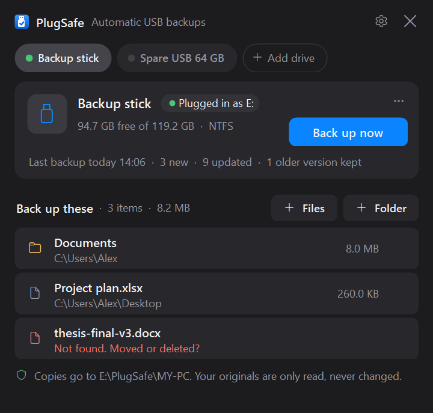
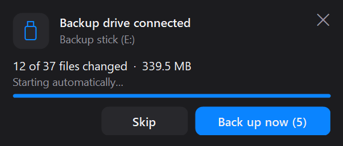
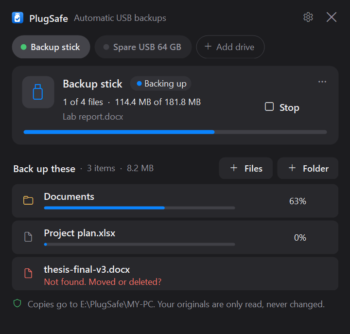

# PlugSafe

Automatic backups to a USB drive on Windows. Choose your files and folders once. From then on, every time you plug in **that** drive, PlugSafe copies whatever changed, with no clicking.



## Features

- **Knows your drive**: it recognises the drive you added by an ID file and the drive's serial number, and ignores every other drive.
- **Hands-free**: a small popup counts down 5 seconds, then copies only what changed. Press Skip if you're in a hurry.
- **Plain copies**: `PlugSafe\<PC name>\Latest` on the drive is an ordinary folder you can open on any computer. Older versions go to `Versions\<date>`: one per day, plus an extra one when a file changes a lot.
- **Progress and quick open**: see progress per file and folder, and click an item to open its backup copy.
- **Reminders**: it nudges you after a week without a backup, warns when the drive is nearly full, and helps you delete old versions.
- **Skips junk folders**: build and cache folders such as `node_modules`, `.git` and `__pycache__` are left out (you can edit the list).
- **Light**: uses no CPU while it waits in the tray.



## Safety

- Your original files are only ever read: never changed, moved or deleted.
- It only writes inside the `PlugSafe` folder on the drive you added. Every write is checked against that drive's serial number, and links or junctions are refused.
- Each file is written to a temporary copy, flushed to the drive, read back and checked with SHA-256 before it replaces the previous copy. If a backup is interrupted, it is tidied up the next time.
- 51 automated safety self-tests: `PlugSafe.exe --selftest <empty folder>`.



## Install

1. Download `PlugSafe.zip` from [Releases](../../releases), extract it and run **Install PlugSafe.bat**. It installs the .NET 10 Desktop Runtime if needed.
2. Windows may say "Windows protected your PC" because the app isn't code-signed. Click **More info → Run anyway**, or build it yourself.
3. Plug in your USB drive, click **Add drive**, then **+ Files** or **+ Folder**.

Needs Windows 10 or 11 (x64). To uninstall, run **Uninstall PlugSafe.bat**. Your files and your backups stay where they are.

## Privacy

- No accounts, cloud, ads, analytics or telemetry. Your files never leave your PC and your USB drive.
- The only network use is an optional update check, off unless you turn it on (the installer asks). It asks GitHub for the newest version number at most once a week. An update is installed only when you click it, and only if the file matches the SHA-256 checksum published with the release.

## Build from source

You need the [.NET 10 SDK](https://dotnet.microsoft.com/download/dotnet/10.0).

```bash
powershell -ExecutionPolicy Bypass -File build.ps1     # builds app\PlugSafe.exe
powershell -ExecutionPolicy Bypass -File package.ps1   # builds release\ (zip, exe and .sha256 for a GitHub release)
```

## Honest note

I made this to protect my own uni work, mostly with AI help (Claude Code), and tested it on my own Windows 11 PC. It's careful by design, but it's a hobby project with no warranty. For anything you can't afford to lose, keep a second backup somewhere else too. Issues and pull requests are welcome.

## Licence

[MIT](LICENSE), with no warranty.
