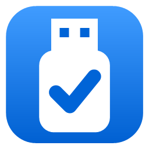
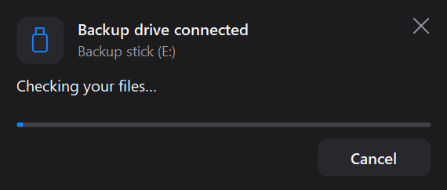
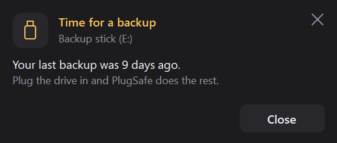
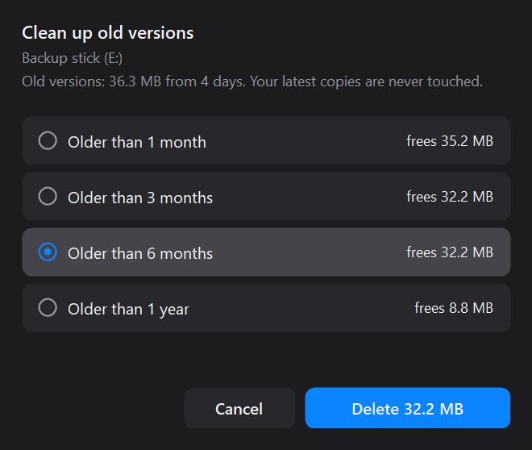
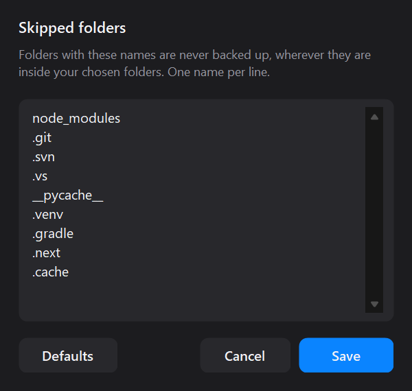

<p align="center">
  
</p>

<h1 align="center">PlugSafe</h1>

<p align="center"><b>Plug in your USB drive. Your files back themselves up.</b></p>

<p align="center">
  <a href="https://github.com/DovisLe/PlugSafe/releases/latest"></a>
  
  
</p>

<p align="center">
  
</p>

<table align="center">
  <tr>
    <td align="center">1️⃣<br><b>Add your USB drive</b></td>
    <td align="center">2️⃣<br><b>Pick files and folders</b></td>
    <td align="center">3️⃣<br><b>Plug it in. Done.</b></td>
  </tr>
</table>

<h2 align="center">🔌 Plug in, and it just happens</h2>

<p align="center">
  
</p>

<table align="center">
  <tr>
    <td>🛡️ <b>Originals never touched</b>, only read</td>
    <td>✅ <b>Every copy verified</b> with SHA-256</td>
  </tr>
  <tr>
    <td>🗂️ <b>Daily versions</b>, plus one on big changes</td>
    <td>💻 <b>Plain files</b> you can open on any PC</td>
  </tr>
  <tr>
    <td>🎯 <b>Only your drive</b>, checked by ID and serial</td>
    <td>🪶 <b>No CPU</b> while it waits</td>
  </tr>
</table>

<table align="center">
  <tr>
    <th>🔔 Reminds you</th>
    <th>🧹 Cleans up old versions</th>
    <th>🚫 Skips junk folders</th>
  </tr>
  <tr>
    <td align="center" valign="top"></td>
    <td align="center" valign="top"></td>
    <td align="center" valign="top"></td>
  </tr>
</table>

## 🚀 Get started

1. Download **PlugSafe.zip** from [the latest release](https://github.com/DovisLe/PlugSafe/releases/latest), extract it, run **Install PlugSafe.bat**.
2. Plug in your USB drive, click **Add drive**, then **+ Files** or **+ Folder**.

<sub>"Windows protected your PC"? The app isn't code-signed: click <b>More info → Run anyway</b>.</sub>

## 🔒 Privacy

No accounts, cloud, ads or tracking. Your files never leave your PC and your USB drive. The weekly update check is off unless you turn it on, and it only asks GitHub for the newest version number.

<details>
<summary><b>More detail: how it keeps your files safe</b></summary>

- It only ever reads your originals; it never changes, moves or deletes them.
- It recognises your drive by an ID file and the drive's serial number, and ignores every other drive.
- It only writes inside the `PlugSafe` folder on that drive, and refuses links and junctions.
- Each file is copied to a temporary file, flushed, read back and checked before it replaces the previous copy. If a backup is interrupted, it is tidied up next time.
- On the drive, `PlugSafe\<PC name>\Latest` holds the newest copies and `Versions\<date>` holds older ones.
- Updates install only when you click, and only if the file matches the release's SHA-256 checksum.
- There are 51 automated safety self-tests: `PlugSafe.exe --selftest <empty folder>`.

**Build from source.** You need the [.NET 10 SDK](https://dotnet.microsoft.com/download/dotnet/10.0).

```bash
powershell -ExecutionPolicy Bypass -File build.ps1     # builds app\PlugSafe.exe
powershell -ExecutionPolicy Bypass -File package.ps1   # builds release\ (zip, exe and .sha256)
```

</details>

---

<sub>Made to protect my own uni work, mostly with AI help (Claude Code), and tested on my own Windows 11 PC. It's careful by design, but it's a hobby project with no warranty, so keep a second backup of anything you can't lose. Issues and pull requests are welcome. <a href="LICENSE">MIT licence</a>.</sub>
